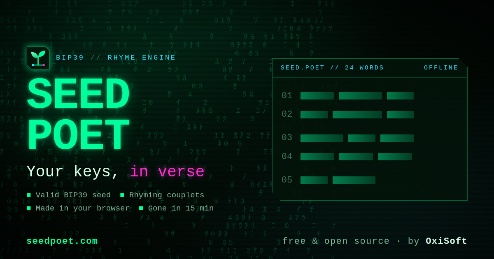

# Seed Poet: BIP39 seed phrase generator that writes your wallet key as a rhyming poem

[](https://github.com/abkvme/seed-poet/actions/workflows/pipeline.yml)
[](https://github.com/abkvme/seed-poet/releases) [](https://pkg.go.dev/github.com/abkvme/seed-poet/v2/seedpoet)
[](LICENSE)
[](https://seedpoet.com)

**[Try it at seedpoet.com](https://seedpoet.com)**: free, open source, runs in your browser, works offline.

[](https://seedpoet.com)

Seed Poet generates a new **BIP39 mnemonic** (12 or 24 words) and writes it as **rhyming couplets**, so the
recovery phrase of your crypto wallet is easier to remember and harder to mistype:

```
road word ring
wage wise thing
inform tree finger
letter snow trigger
```

Read word by word, every poem is a **valid BIP39 English seed phrase with a correct checksum**, so any BIP39
wallet accepts it. (This one is a published test vector: never use a phrase anyone else has seen.)

## Works with your blockchain and wallet

A Seed Poet poem is a standard BIP39 recovery phrase. Import it into any wallet that restores from a 12 or
24-word BIP39 phrase:

- **Bitcoin** (BTC), Litecoin (LTC), Dogecoin (DOGE), Bitcoin Cash (BCH)
- **Ethereum** (ETH) and EVM networks: Polygon, BNB Chain, Arbitrum, Optimism, Base, Avalanche C-Chain
- **Solana** (SOL)
- **Cardano** (ADA): use 24 words
- Polkadot (DOT), Cosmos (ATOM), Tron (TRX)
- Wallets such as Ledger, Trezor, MetaMask, Trust Wallet, Phantom and Exodus

Not for Monero, which uses its own 25-word seed format.

## Features

- **Memorable**: VERB + ADJECTIVE + NOUN lines, the nouns of each couplet rhyme, line pairs have matching syllable counts.
- **Valid BIP39**: correct checksum, every word from the official 2048-word English list.
- **Private by design**: on [seedpoet.com](https://seedpoet.com) the poem is generated in your browser with
  `crypto.getRandomValues`. The page is not allowed to make network requests (`connect-src 'none'`), uses no
  cookies, analytics or third-party code, and never stores or logs a poem.
- **Disappears**: a 15-minute countdown, a "hide now" button, and the poem is wiped whenever you leave the page, so the
  next person at the same browser cannot go back to it.
- **Printable**: download a one-page PDF built in the browser (no library, no upload) with the poem and the numbered words.
- **Offline**: installs as an app (PWA) and keeps working without internet; or download the
  [single-file offline version](https://seedpoet.com/seedpoet-offline.html) for an air-gapped computer.
- **No JavaScript?** The server can write a poem instead: shown once, never stored or logged.
- **Two identical libraries**: Go and dependency-free JavaScript produce exactly the same poem from the same random bytes.

## How strong is a poem seed?

Rhymes and grammar limit which words can go where, so a poem holds a little less randomness than a fully random
BIP39 phrase of the same length. Our estimate:

| Words | Seed Poet | Fully random BIP39 |
|---|---|---|
| 12 | about 88 bits | 128 bits |
| 24 | about 176 bits | 256 bits |

88 bits is still about 3 x 10^26 possible poems, far beyond any known brute-force attack, even by someone who knows
you used Seed Poet. For a wallet that holds real value, use **24 words**, ideally with the offline version on a
computer without internet.

## Use it

### In the browser

Open **[seedpoet.com](https://seedpoet.com)** and pick 12 or 24 words. Install it from the browser menu to use it
as an app.

### Command line (Go)

```bash
go install github.com/abkvme/seed-poet/v2/cmd/seedpoet@latest
seedpoet 24
```

Or download a binary for Linux, macOS or Windows from [Releases](https://github.com/abkvme/seed-poet/releases)
(checksums in `SHA256SUMS`).

### Go library

```go
import "github.com/abkvme/seed-poet/v2/seedpoet"

poem, err := seedpoet.Generate(24) // crypto/rand
if err != nil { ... }
fmt.Println(poem.Format())         // 8 rhyming lines
words := poem.Words()              // the 24-word mnemonic
err = seedpoet.Validate(words)     // BIP39 checksum check
```

### JavaScript library (browser and Node.js, no dependencies)

[`js/seedpoet.js`](js/seedpoet.js) is a line-for-line port of the Go library, including its own SHA-256 for
the checksum, so it also works from a file on an offline computer.

```html
<script src="data.js"></script>      <!-- word data: web/dist/assets/data.*.js -->
<script src="seedpoet.js"></script>
<script>
  const gen = SeedPoet.createGenerator(SeedPoetData);
  const poem = gen.generate(24);            // crypto.getRandomValues
  console.log(poem.format());
  console.log(gen.validate(poem.words()));  // null = valid BIP39
</script>
```

In Node.js (19 or newer) load the data from `data/`:

```js
const fs = require('fs');
const SeedPoet = require('./js/seedpoet.js');
const json = require('./data/seedpoet.json');
const bip39 = fs.readFileSync('./data/english.txt', 'utf8').split(/\s+/).filter(Boolean);
const gen = SeedPoet.createGenerator({ bip39, ...json });
console.log(gen.generate(12).format());
```

### Self-hosting

```bash
docker build -t seedpoet .
docker run -p 8080:8080 seedpoet           # http://localhost:8080
# or
go run ./cmd/seedpoet serve 127.0.0.1:8080
```

The binary embeds the whole website. In production, [seedpoet.com](https://seedpoet.com) serves `web/dist` as
static files from nginx and runs the Go server only for the no-JavaScript fallback (`POST /nojs/12|24`).

## How it works

1. Pick 2 (12 words) or 4 (24 words) rhyme groups at random from 78 phonetic groups of BIP39 nouns.
2. For each couplet, pick two rhyming nouns with similar syllable counts.
3. Line 1: random verb + adjective + noun. Line 2: a verb + adjective pair whose syllables match line 1.
4. Check the BIP39 checksum of the whole phrase; if it is wrong, draw a new poem (about 1 in 16 poems pass for
   12 words, 1 in 256 for 24). Rejection keeps the result uniform among valid poems.

Both libraries turn random bytes into numbers with the same documented rules
([internal/rng](internal/rng/rng.go)): 4 bytes big-endian per number, rejection sampling for ranges, Fisher-Yates
shuffles. [`testdata/vectors.json`](testdata/vectors.json) holds poems generated by Go from fixed test streams; the
JavaScript tests must reproduce them word for word.

## Development

```bash
make test        # Go tests (race detector) + JavaScript tests (node --test, no npm install)
make web         # rebuild the website into web/dist (CI fails if it is stale)
make run         # build and serve on 127.0.0.1:8080
make e2e         # browser tests: Chromium + Firefox, PDF, offline, PWA (needs uv)
make generate    # rebuild data/seedpoet.json from the Python word lists
```

| Path | What |
|---|---|
| `seedpoet/` | Public Go package |
| `internal/` | Generator, rhyme index, syllable counter, BIP39 checksum, random number rules, web server |
| `js/` | JavaScript library and its tests |
| `data/` | Official BIP39 `english.txt` and `seedpoet.json` (word categories, rhyme groups), shared by Go and JS |
| `web/` | Website templates, CSS/JS sources, generated `dist/`, image and browser-test tools |
| `cmd/seedpoet` | CLI and server; `cmd/buildweb` builds the website |
| `scripts/` | Python sources of the word categories and rhyme groups |

## License

MIT, see [LICENSE](LICENSE).

Developed by **[OxiSoft](https://oxisoft.io)**, a privacy-first software studio. Live at
**[seedpoet.com](https://seedpoet.com)**.
